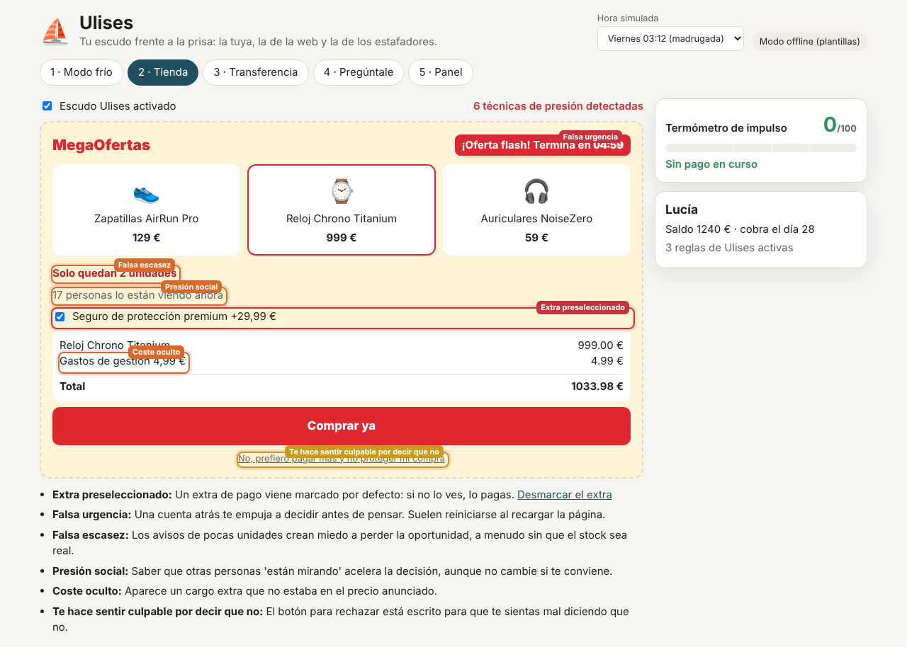
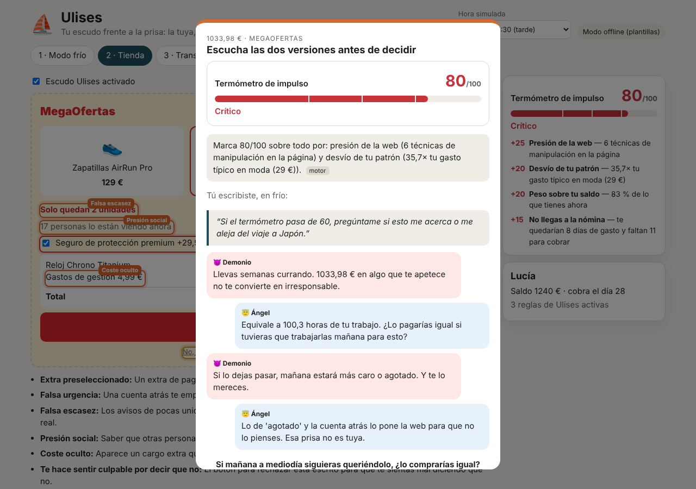
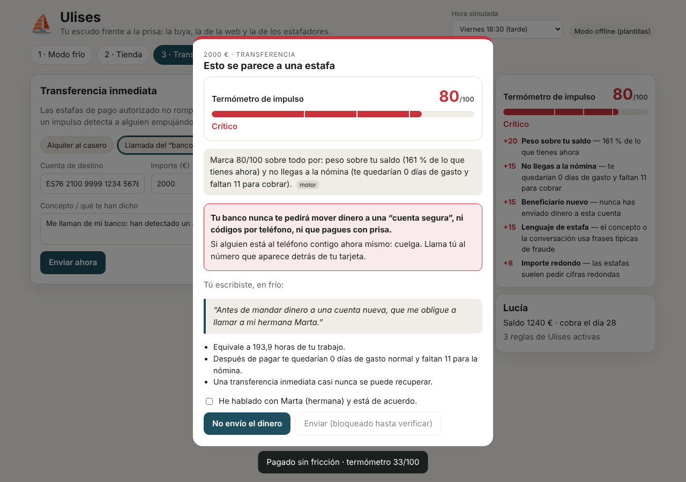
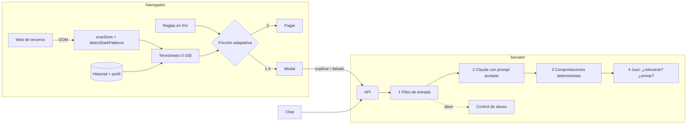

# ⛵ Ulises — tu escudo frente a la prisa

> **La tuya, la de la web y la de los estafadores.**
> Ulises mide en tiempo real cuánta presión rodea a un pago y aplica la fricción justa: ninguna para lo cotidiano y un freno firme cuando alguien (tú mismo, una tienda o un estafador) te empuja a pagar con prisa.

| Escudo contra dark patterns | Debate Ángel / Demonio | Escudo antiestafa |
|---|---|---|
|  |  |  |

---

## Para el jurado: en 60 segundos

| | |
|---|---|
| **Problema** | Las decisiones de pago malas no suelen ser de información: son de **presión**. Cuentas atrás falsas, extras premarcados, compras de madrugada y estafas que fabrican urgencia por teléfono. |
| **Idea** | Un **termómetro de impulso** (0–100, explicable señal a señal) que decide cuánta **fricción adaptativa** aplicar, respetando las **reglas que el usuario escribió en frío** (el *contrato de Ulises*). |
| **Por qué es nuevo** | Los bancos ya dan *insights* **después** de gastar y los bloqueos van por categoría. Ulises actúa **antes** del pago, mide también la **presión externa** (dark patterns de la web) y usa **la misma señal** para frenar impulsos y estafas. Ver [`docs/ideacion-ia.md`](docs/ideacion-ia.md). |
| **Dónde está la IA** | (1) Motor de puntuación con señales de comportamiento; (2) detector de manipulación sobre el DOM de cualquier web; (3) Claude explica, debate y responde preguntas **solo con cifras calculadas por el motor**, detrás de 4 capas de guardarraíles y un juez de segunda pasada. |
| **Caso de negocio** | En Reino Unido, el reembolso obligatorio del fraude de pago autorizado (hasta 85.000 £, desde oct. 2024) hace que **cada estafa frenada sea dinero que el banco no paga**. Los intereses del banco y del cliente se alinean. |
| **Ética** | Trabaja **solo para el usuario**. La puntuación nunca se comparte con comercios (art. 5 del AI Act: prohibido explotar vulnerabilidades). La protección antiestafa **no se suspende nunca**, ni siquiera a quien abusa del chat. |

## Probarlo

```bash
npm install
npm run dev          # web en http://localhost:5173 · API en :8787
```

- **Sin clave de API** funciona entero en **modo offline**: el motor es determinista y la voz usa plantillas.
- **Con IA:** `cp .env.example .env` y rellena `ANTHROPIC_API_KEY`. El servidor lee el `.env` solo; al arrancar verás `voz: Claude`.
- **Versión de escenario:** `npm run demo` → todo en http://localhost:8787.
- **Tests:** `npm test` (43 tests: motor, escudo, fricción, guardarraíles y control de abuso).

**Guion de demo de 3 minutos:** [`docs/guion-demo.md`](docs/guion-demo.md).

## Qué hace, pieza a pieza

| # | Pieza | Qué ves en la demo | Código |
|---|---|---|---|
| 1 | **Modo frío / Contrato de Ulises** | El usuario escribe sus reglas en calma: *“Si compro de madrugada algo de más de 80 €, espérame 12 horas”*. | `src/ui/ColdMode.tsx`, `src/core/ulises.ts` |
| 2 | **Escudo contra dark patterns** | Sobre una tienda de terceros marca falsa urgencia, falsa escasez, presión social, extras premarcados, *confirmshaming* y costes ocultos. El escáner es **genérico**: lee el DOM sin saber nada de la tienda. | `src/core/darkPatterns.ts`, `src/ui/scanDom.ts` |
| 3 | **Termómetro de impulso** | Una puntuación de 0 a 100 en la que **cada punto tiene nombre**: desvío de tu patrón, peso sobre tu saldo, si llegas a la nómina, compras en cadena, hora poco habitual *para ti*, categoría de impulso, presión de la web y patrón de estafa. | `src/core/thermometer.ts` |
| 4 | **Fricción adaptativa** | 5 niveles: sin fricción → aviso → **debate Ángel/Demonio** → **tu propia regla** → **escudo antiestafa**. | `src/core/ulises.ts`, `src/ui/FrictionModal.tsx` |
| 5 | **Escudo antiestafa** | Una transferencia redonda a una cuenta nueva con “cuenta segura” en el concepto queda bloqueada hasta verificar con el contacto que eligió el usuario. | `measure()` señal 8 |
| 6 | **Pregúntale a Ulises** | Chat **limitado a la cuenta**. Rechaza la petición “hazme una landing page en HTML” y los intentos de inyección. Si alguien abusa, suspende el chat de forma escalonada (5 min → 15 min → 30 min → 1 h → 1 día). | `server/llm.ts`, `server/guardrails.ts`, `server/abuse.ts` |
| 7 | **Panel** | Euros protegidos, impulsos frenados, estafas interceptadas y pagos sin fricción. | `src/ui/Dashboard.tsx` |

## Arquitectura



- El **motor** (`src/core`) es TypeScript puro, sin dependencias y testeado. Corre en el navegador, que en producción sería el móvil: **los datos no salen del dispositivo para puntuar**.
- El **LLM nunca calcula**: recibe las cifras ya calculadas y los guardarraíles rechazan cualquier número que no esté en los datos.
- Detalle completo: [`docs/arquitectura.md`](docs/arquitectura.md) · Guardarraíles y abuso: [`docs/guardrails.md`](docs/guardrails.md).

## IA responsable: guardarraíles

Cada respuesta de la IA atraviesa **4 capas** antes de llegar al usuario:

1. **Filtro de entrada:** limita la longitud, elimina markup y bloquea la inyección de prompt y las peticiones fuera de ámbito, que **nunca llegan al modelo**.
2. **Prompt acotado:** el texto del usuario va dentro de `<datos_usuario>` y se trata como información, nunca como órdenes.
3. **Comprobaciones deterministas:** rechazan código, HTML, enlaces, veredictos (“debes comprarlo”), productos financieros y **cifras inventadas**.
4. **Juez de segunda pasada:** otra llamada a la IA pregunta *“¿esto es relevante para el banco y la cuenta del usuario? ¿lo envío?”*. Solo se envía con un **sí explícito** en relevancia, seguridad y fidelidad. Si hay error o duda, **no se envía** (falla cerrado).

A eso se suma el **control de abuso**: suspensión escalonada y la etiqueta **“AI abuser”** en el perfil, con caducidad, motivo visible y revisión humana. Además, **nunca** afecta al crédito ni desactiva la protección antiestafa.

## Estructura

```
src/core/      motor puro: termómetro, dark patterns, reglas de Ulises, datos sintéticos (+ tests)
src/ui/        React: tienda demo, modo frío, modal de fricción, chat, panel
server/        Express: Claude, guardarraíles, juez, control de abuso (+ tests)
docs/          ideación, arquitectura, guardarraíles, guion de demo, capturas
```

## Limitaciones (honestas)

- **Los pesos del termómetro son heurísticos.** El siguiente paso es calibrarlos con una etiqueta real de arrepentimiento: devoluciones en ≤14 días, descubiertos en ≤7 días o autoetiquetado del usuario.
- **Los datos son sintéticos** (90 días de una persona ficticia, generados con semilla fija).
- **El detector de dark patterns usa reglas en español.** Funciona sobre cualquier DOM, pero no ve trucos puramente visuales (colores o tamaños de botón).
- **El estado de abuso vive en memoria;** en producción iría en la base de datos del banco.
- **El testing con usuarios de `docs/ideacion-ia.md` es simulado** y está marcado como tal.

## Stack

TypeScript · React 19 · Vite · Express · Zod · Vitest · Claude (`claude-opus-5-5` vía `@anthropic-ai/sdk`, con *fallback* de servidor y salidas estructuradas).
