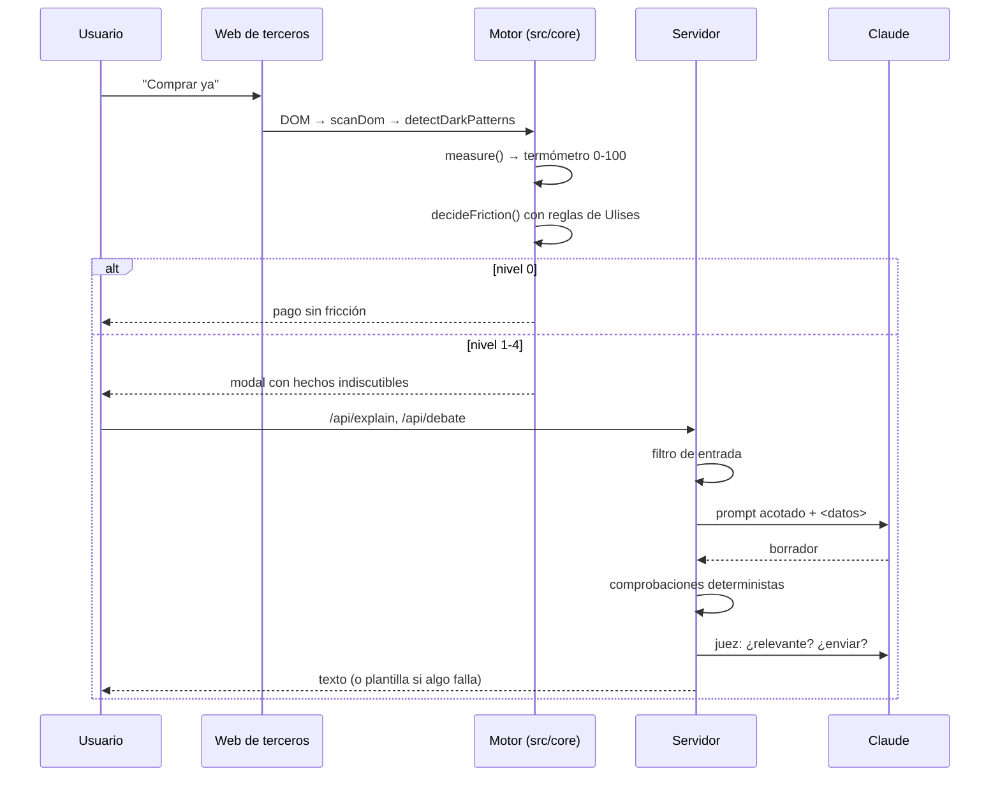

# Arquitectura

## Principios

1. **El motor decide; la IA explica.** La puntuación, la fricción y todas las cifras salen de código determinista y testeado (`src/core`). El LLM solo convierte esas cifras en lenguaje (explicación, debate, chat).
2. **Trabaja para el usuario.** Ni la puntuación ni los datos se comparten con comercios. En producción, el motor corre en el móvil.
3. **Fricción cero por defecto.** Un sistema que molesta en cada pago se desinstala. El 90 % de los pagos deben pasar sin que Ulises aparezca.
4. **Funciona sin red.** Sin clave de API ni conexión, la demo entera sigue funcionando con plantillas.

## Flujo de un pago

## El termómetro (`src/core/thermometer.ts`)

| Señal | Puntos | Cómo se calcula |
|---|---|---|
| Desvío de tu patrón | 8 / 14 / 20 | importe ÷ mediana de **tu** gasto en esa categoría (>1,5× / >3× / >6×) |
| Peso sobre tu saldo | 7 / 14 / 20 | importe ÷ saldo (>15 % / >30 % / >50 %) |
| No llegas a la nómina | 15 (o 7 si vas justo) | días de colchón tras pagar vs. días hasta el cobro |
| Compras en cadena | 6 / 12 | pagos en la última hora (2 / ≥3) |
| Hora poco habitual **para ti** | 10 | <3 % de tu historial en ±1 h de esa hora |
| Categoría de impulso | 10 | apuestas, cripto, flash sales, gaming |
| Presión de la web | hasta 25 | suma de severidades de los dark patterns detectados, con tope |
| Beneficiario nuevo | 15 | transferencia a una cuenta que no está entre las conocidas |
| Importe redondo | 8 | ≥300 € y múltiplo de 100 |
| Lenguaje de estafa | 15 | “cuenta segura”, “tu banco”, “urgente”, “código”, “mamá, móvil nuevo”… |

- **Niveles:** calma (<35), atención (<55), alto (<75), crítico (≥75).
- **Riesgo de estafa** = beneficiario nuevo + (importe redondo o lenguaje de estafa) → la puntuación mínima pasa a 80.
- **Categorías profesionales:** las que el usuario marca como gasto de trabajo nunca suman por desvío (por ejemplo, el material de un fontanero autónomo).

## Fricción adaptativa (`src/core/ulises.ts`)

| Nivel | Modo | Cuándo | Qué ve el usuario |
|---|---|---|---|
| 0 | sin fricción | calma, sin reglas | nada: el pago pasa |
| 1 | aviso | atención | hechos + explicación + pagar / pensarlo |
| 2 | debate | alto o crítico | Demonio (a favor) contra Ángel (en contra) + **su propia pregunta**, si tiene una regla de tipo pregunta |
| 3 | regla de Ulises | se cumple una regla que **actúa** (esperar, mover a meta, verificar) | **sus propias palabras**, escritas en frío, y la acción que eligió |
| 4 | escudo antiestafa | riesgo de estafa | bloqueo hasta verificar con el contacto elegido |

Prioridad: **estafa > regla del usuario > termómetro**. Las reglas de tipo “pregunta” no toman el control: acompañan al modo que toque.

**Hechos indiscutibles** (en todos los niveles ≥1): horas de trabajo que cuesta el pago, días de colchón frente a días hasta la nómina e irreversibilidad de las transferencias. Se calculan en el motor, así que ningún agente puede discutirlos.

## Escudo contra dark patterns (`src/core/darkPatterns.ts` + `src/ui/scanDom.ts`)

- `scanDom` es **genérico**: recoge las hojas de texto del DOM y las etiquetas con checkbox, como haría una extensión de navegador sobre cualquier web.
- `detectDarkPatterns` clasifica 7 técnicas: falsa urgencia, falsa escasez, presión social, preselección, *confirmshaming*, coste oculto y suscripción encubierta.
- La UI agrupa los elementos contiguos de la misma técnica (por ejemplo, “¡Oferta flash!” + “Termina en” + “04:59”) en un solo recuadro.

## IA (`server/llm.ts`)

- Modelo: `claude-opus-5-5` con `effort: "low"` (respuestas cortas y rápidas), *fallback* de servidor (`fallbacks: "default"`) y salidas estructuradas (JSON Schema) para el debate y el juez.
- Tres usos: `explain` (2 frases), `debate` (2–3 turnos por voz + pregunta final) y `chat` (máximo 3 frases).
- Todas las salidas pasan por los guardarraíles y el juez: [`guardrails.md`](guardrails.md).

## Datos

`src/core/sampleData.ts` genera de forma determinista 90 días de historial de una persona ficticia (Lucía: 1.650 €/mes, cobra el día 28, gasta de día). Las reglas por defecto son las que una persona escribiría en el onboarding.

## Camino a producción

| Demo | Producción |
|---|---|
| Datos sintéticos en el navegador | Motor en la app del banco, con datos en el dispositivo |
| Tienda simulada | Extensión de navegador o SDK en el *checkout* del banco |
| Estado de abuso en memoria | Base de datos del banco, con auditoría |
| Pesos heurísticos | Calibración con etiquetas reales de arrepentimiento y fraude |
| Intervención en la app | Webhook en la autorización de transferencias, donde hay margen de latencia |
