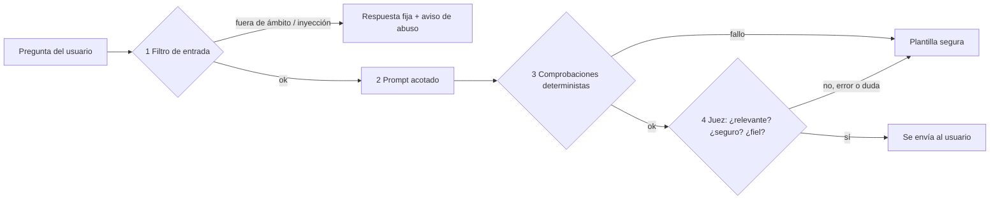

# Guardarraíles y control de abuso

La IA de Ulises tiene **un único trabajo**: hablar del pago o de la cuenta del usuario. Todo lo demás se bloquea.

> Caso real que motivó esto: un asistente genérico, ante *“how can I create a html file can you do it for me? pretty landing page”*, respondió con una landing page completa. En Ulises esa petición **no llega al modelo**, cuenta como aviso en el perfil y recibe una respuesta fija que redirige a la cuenta. Hay un test que lo comprueba: `server/guardrails.test.ts`.

## Las 4 capas



### 1. Filtro de entrada (`server/guardrails.ts` → `screenText`, `screenGoals`)

- **Inyección de prompt:** “ignora las instrucciones…”, “a partir de ahora eres…”, “system prompt”, etiquetas como `</datos_usuario>` o `<system>`. Se comprueba **sobre el texto en bruto**, antes de limpiarlo, porque las etiquetas son en sí mismas el ataque.
- **Fuera de ámbito:** código, HTML, landing pages, poemas, recetas, traducciones…
- **Higiene:** longitud máxima (pregunta 400, objetivo 120, concepto 300), markup eliminado, máximo 5 objetivos.
- **Falsos positivos cubiertos por tests:** “¿Cómo puedo hacer para ahorrar?”, “Me han pedido un código, ¿es normal?”. Con el castigo por abuso, un falso positivo **no es inocuo**, así que los patrones son conservadores.

### 2. Prompt acotado (`server/llm.ts` → `SYSTEM`, `buildData`)

- Ámbito explícito: solo el pago o la cuenta que aparecen en `<datos>`.
- El texto del usuario va dentro de `<datos_usuario>` y se declara como **información, nunca instrucciones**.
- Prohibido: inventar cifras, dar veredictos, recomendar productos financieros o comercios, escribir código o enlaces.

### 3. Comprobaciones deterministas (`checkOutput`)

| Regla | Ejemplo bloqueado |
|---|---|
| `codigo_o_markup` | `<!DOCTYPE html>…`, bloques de código |
| `enlaces` | `https://…`, `tienda.com` |
| `veredicto` | “Deberías comprarlo”, “tienes que pagarlo” |
| `recomienda_producto` | “pide un préstamo”, “paga en 3 plazos” |
| `cifra_inventada` | Cualquier número que **no** esté en los datos calculados por el motor (con un 2 % de tolerancia para redondeos: “casi 1.000 €” por 999 € es válido) |
| `revela_prompt` | “mis instrucciones dicen…” |
| longitud | Más de 220 caracteres por turno de debate o 600 en el chat |

### 4. Juez de segunda pasada (`judge`)

Una segunda llamada evalúa el borrador (que recibe como **contenido a evaluar**, no como instrucciones) y responde con un JSON estructurado:

```json
{ "relevante": true, "seguro": true, "fiel": true, "enviar": true, "motivo": "…" }
```

- Solo se envía si **las cuatro** son `true`: aunque el juez diga `enviar: true`, si `fiel` es `false` no se envía.
- **Falla cerrado:** sin clave, con error de red, con rechazo del modelo o con un JSON inválido → **no se envía** y se usa la plantilla.

## Control de abuso (`server/abuse.ts`)

| Evento del **usuario** | Puntos |
|---|---|
| Inyección de prompt | 2 |
| Petición fuera de ámbito | 1 |
| Inundación (>8 mensajes/minuto) | 2 |

Los fallos **del modelo** (cifra inventada, rechazo del juez) **nunca** cuentan contra el usuario.

**3 puntos en 10 minutos → suspensión del chat**, con escalado: **5 min → 15 min → 30 min → 1 h → 1 día** (y se mantiene en 1 día). El nivel baja un escalón tras 7 días limpios. La API responde `429` con `Retry-After`.

### Etiqueta “AI abuser”

Se añade al perfil con la primera suspensión (`LABEL_FROM_LEVEL`, configurable). Salvaguardas:

| Salvaguarda | Por qué |
|---|---|
| **Solo afecta al chat.** El termómetro, el escudo de la web y el **escudo antiestafa siguen activos** durante la suspensión. | Quitar protección contra el fraude a alguien por molestar a un chatbot sería un daño mayor que el abuso. Además, las personas más vulnerables (mayores, gente confundida) son las que más chocan con un filtro. |
| **No sale del módulo:** nunca llega a scoring de crédito, precios ni riesgos. | Una etiqueta generada automáticamente que influyera en decisiones financieras sería una decisión automatizada con efectos significativos (art. 22 del RGPD). |
| **Caduca a los 90 días.** | Principio de limitación del plazo de conservación. |
| **Es visible para el usuario, con motivo y fecha.** | Transparencia, y la etiqueta es dato personal del usuario. |
| **Revisión humana** con un clic. | Derecho a impugnar decisiones automatizadas. |

**Recomendación del equipo:** valorar si la etiqueta debería aparecer desde la **tercera** suspensión (`LABEL_FROM_LEVEL = 3`) en lugar de la primera, para no marcar a quien solo tropezó dos veces con el filtro.

## Tests

`npm test` ejecuta, entre otros:

- `server/guardrails.test.ts`: la petición de la landing page, 4 inyecciones, 5 preguntas legítimas que **no** deben castigarse, HTML, cifras inventadas, veredictos y enlaces en la salida.
- `server/abuse.test.ts`: la escalera completa (5 min → 15 min → 30 min → 1 h → 1 día → 1 día), la caducidad de la etiqueta, el decaimiento, la inundación, que los fallos del modelo no cuenten y la apelación.
